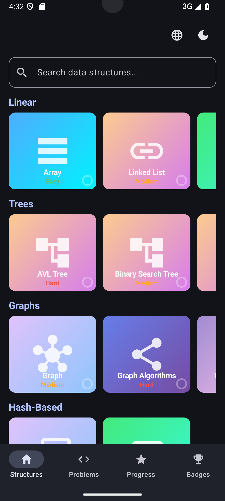
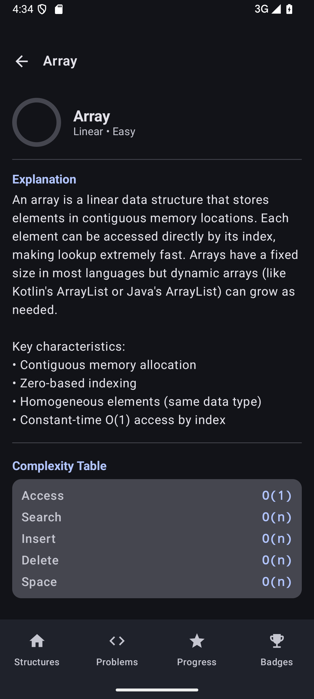
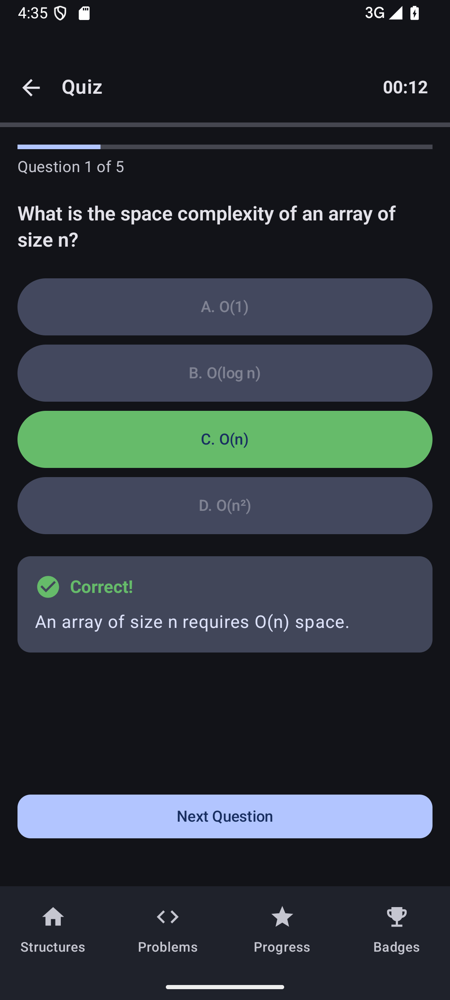
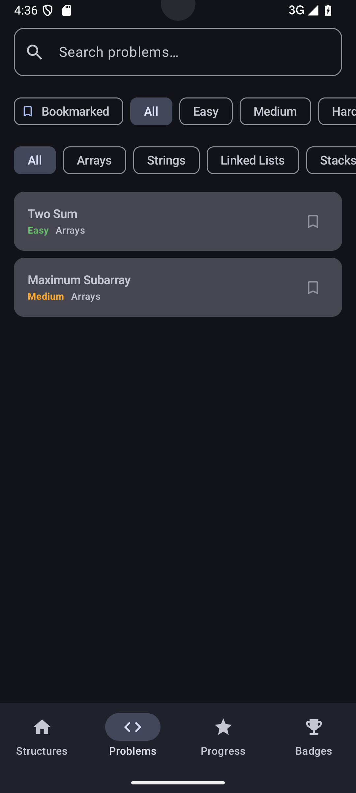
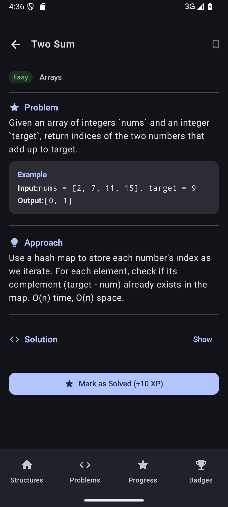
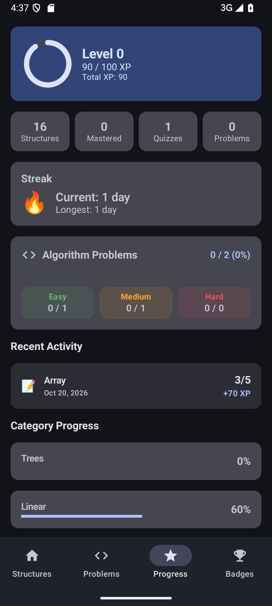
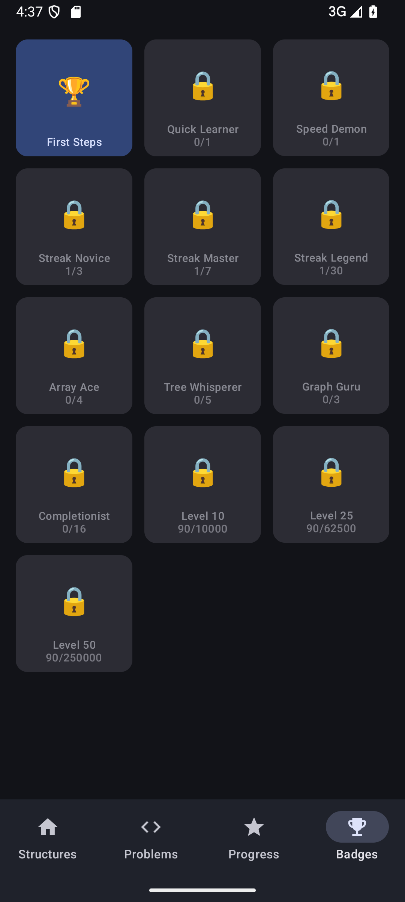
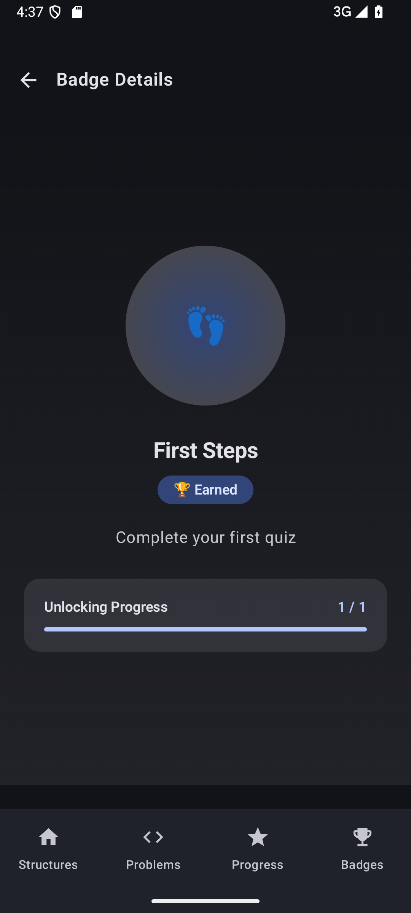
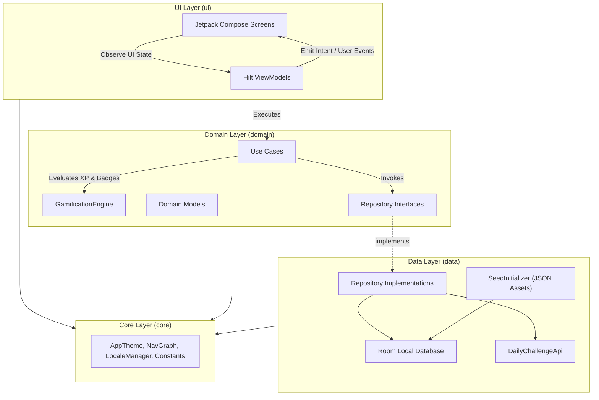

# 💻 HackerRank Data Structures — Learning App for Android

<p align="center">
  <a href="https://github.com/suryamudti/hackerrank-app/actions/workflows/pr-check.yml"></a>
  <a href="https://github.com/suryamudti/hackerrank-app/actions/workflows/release.yml"></a>
  <a href="https://kotlinlang.org"></a>
  <a href="https://developer.android.com/about/versions/oreo"></a>
  <a href="https://developer.android.com/jetpack/compose"></a>
  <a href="https://dagger.dev/hilt/"></a>
</p>

<p align="center">
<b>HackerRank Data Structures</b> demonstrates modern Android development with Kotlin, Jetpack Compose (Material 3), Coroutines, Flow, Hilt, Navigation Compose, and Room based on <b>MVVM Architecture</b> and <b>Clean Architecture</b> guidelines, featuring interactive data structure guides, timed MCQ quizzes, 100 algorithm problems, and full gamification.
</p>

---

## 📥 Download

Go to the [Releases](https://github.com/suryamudti/hackerrank-app/releases) section to download the latest APK.

---

## 📸 Screenshots

| Data Structures | Structure Detail | MCQ Quiz | Algorithm Problems |
| :---: | :---: | :---: | :---: |
|  |  |  |  |

| Problem Detail | Progress Dashboard | Achievement Badges | Badge Detail |
| :---: | :---: | :---: | :---: |
|  |  |  |  |

---

## 🌟 Key Features

| Feature | Description |
|---|---|
| **🗂️ 16 Data Structures** | Categorized across 5 domains: Linear, Trees, Graphs, Hash-Based, and Other, with search and difficulty badges. |
| **📖 Educational Content** | Comprehensive guides per structure with explanations, time/space complexity tables (`O(1)`, `O(log n)`, `O(n)`), Kotlin code examples, and real-world use cases. |
| **⏱️ MCQ Quiz Engine** | Timed 30-second per-question quizzes with instant answer verification, explanations, scoring, and mastery calculation. |
| **💻 100 Algorithm Problems** | Searchable and filterable by difficulty (`Easy`, `Medium`, `Hard`) and category, complete with problem statements, constraints, examples, approach notes, and Kotlin solutions. |
| **🔥 Daily Challenge** | Remote daily algorithm challenge banner with bonus XP rewards and offline fallback support. |
| **🏆 Full Gamification** | Experience points (XP), 50 progression levels, daily login/study streaks,confetti celebrations, and 13 unlockable achievement badges. |
| **📊 Progress Dashboard** | Visual mastery rings, per-structure mastery percentages, category progress bars, streak counters, and recent activity logs. |
| **🔖 Problem Bookmarks** | Save favorite or challenging algorithm problems locally in Room for quick filtering and review. |
| **🌐 Bilingual UI** | Full English and Bahasa Indonesia (`values-in`) localization with runtime language switching and grammatical `<plurals>` support. |
| **🎨 Material Design 3** | Dynamic color theming (Light, Dark, and System modes), custom semantic tokens, adaptive monochrome launcher icon, and edge-to-edge transparency. |

---

## 🛠️ Tech Stack & Open-Source Libraries

### Architecture & Core
- **[Kotlin](https://kotlinlang.org/)** (2.0.21): Modern, expressive, and concise programming language.
- **[Android Gradle Plugin](https://developer.android.com/build)** (8.7.0): Modern Android build pipeline.
- **[Coroutines](https://github.com/Kotlin/kotlinx.coroutines)** + **[Flow](https://kotlin.github.io/kotlinx.coroutines/kotlinx-coroutines-core/kotlinx.coroutines.flow/)**: Asynchronous and reactive programming streams.
- **[Hilt](https://dagger.dev/hilt/)** (2.51.1) + **KSP**: Standard dependency injection library for Android.
- **[Navigation Compose](https://developer.android.com/guide/navigation)** (2.8.0): Declarative navigation graph across bottom-bar destinations and detail routes.
- **Clean Architecture + MVVM**: Strict separation of concerns across UI, Domain (Use Cases & Models), and Data layers.

### UI & Styling
- **[Jetpack Compose](https://developer.android.com/jetpack/compose)** (BOM 2024.06.00): Modern declarative UI toolkit.
- **[Material Design 3](https://m3.material.io/)**: Material 3 components, pull-to-refresh containers, custom `MasteryRing` canvas indicators, and `ConfettiOverlay` celebrations.
- **Accessibility (A11y)**: Semantic `contentDescription` labels and Material 3 typography tokens supporting up to 200% font scaling.

### Data & Networking
- **[Room Database](https://developer.android.com/training/data-storage/room)** (2.6.1): Local SQLite persistence for structures, quiz questions, quiz history, user profile, streaks, solved problems, and bookmarks.
- **[Gson](https://github.com/google/gson)** (2.10.1): JSON serialization/deserialization for initial seed assets and daily challenge payloads.
- **`HttpURLConnection`**: Lightweight REST client for fetching remote Daily Challenge metadata.

### Quality, Testing & Static Analysis
- **[JUnit 4](https://junit.org/junit4/)**, **[MockK](https://mockk.io/)** (1.13.12), & **[Turbine](https://github.com/cashapp/turbine)** (1.1.0): Unit testing for ViewModels, Use Cases, GamificationEngine, and reactive Flows.
- **[Robolectric](https://robolectric.org/)** (4.13) & **Compose UI Test**: JVM-based Compose UI component, screen, and Room DAO integration testing (179 tests total).
- **[ktlint](https://pinterest.github.io/ktlint/)** (12.1.1): Kotlin code style and formatting enforcement (`ktlintCheck`).
- **Android Lint**: Strict static analysis with `warningsAsErrors = true` across both `debug` and `release` variants.
- **[JaCoCo](https://www.jacoco.org/jacoco/)**: Automated unit test code coverage reporting and minimum coverage threshold verification.

---

## 🏗️ Architecture & Project Structure

**HackerRank Data Structures** follows **Clean Architecture** and Google's recommended [Guide to app architecture](https://developer.android.com/topic/architecture).

### Project Structure

```
app/src/main/java/com/hackerrank/app/
├── core/                   # Theme, NavigationCompose graph, LocaleManager, Constants
├── data/
│   ├── local/              # Room database (HackerRankDatabase), DAOs, Entities
│   ├── remote/             # DailyChallengeApi client & DTOs
│   ├── repository/         # Repository implementations & entity-domain mappers
│   └── seed/               # JSON asset seed initializer & fallback data
├── di/                     # Hilt dependency injection modules
├── domain/
│   ├── gamification/       # GamificationEngine (XP, levels, streaks, 13 badges)
│   ├── model/              # Immutable domain models
│   ├── repository/         # Focused repository interfaces
│   └── usecase/            # Single-responsibility business logic use cases
└── ui/
    ├── achievements/       # Badge gallery screen & ViewModel
    ├── badge/              # Badge detail screen & ViewModel
    ├── browse/             # Data structures home screen & ViewModel
    ├── components/         # Shared design system composables (MasteryRing, CodeBlock, etc.)
    ├── detail/             # Structure detail view & ViewModel
    ├── problems/           # Algorithm problems list, Daily Challenge banner & detail screen
    ├── progress/           # User progress dashboard & ViewModel
    └── quiz/               # Timed MCQ quiz engine & ViewModel
```

### Layer Architecture Overview



### Architecture & Quality Highlights
- **Offline-First & Self-Seeding**: `SeedInitializer` populates the Room database on first launch from bundled JSON assets (`seed/structures.json`, `seed/quizzes.json`, `seed/problems.json`) with compile-time Kotlin fallbacks.
- **Interface Segregation**: Repository contracts are split by domain concern (`ContentRepository`, `ProblemRepository`, `QuizRepository`, `ProgressRepository`, `ProfileRepository`, `DailyChallengeRepository`).
- **Unidirectional Data Flow (UDF)**: ViewModels expose sealed immutable `StateFlow<UiState>` (`Loading`, `Loaded`, `Error`) to Compose screens.
- **Zero-Warning Quality Gate**: `ktlintCheck`, `lintDebug`, and `lintRelease` run with `warningsAsErrors = true`, backed by 179 unit, DAO, Robolectric UI, and integration tests.

---

## 🌐 Data Sources & APIs

- **Data Structures & Quizzes**: Bundled JSON seed assets (`app/src/main/assets/seed/structures.json` and `seed/quizzes.json`) covering 16 data structures and timed MCQ question banks, persisted in `HackerRankDatabase`.
- **Algorithm Problems**: Bundled JSON corpus (`app/src/main/assets/seed/problems.json`) containing 100 curated problems across Arrays, Strings, Linked Lists, Stacks & Queues, Trees, Graphs, Dynamic Programming, Sorting & Searching, Hashing, and Recursion.
- **Daily Challenge API**: Fetches daily challenge metadata from `https://raw.githubusercontent.com/suryamudti/hackerrank-app/main/daily-challenge.json` via `DailyChallengeApi` with deterministic local fallback when offline.
- **User Progress & Gamification**: Stored 100% locally on-device in SQLite via Room (`user_profile`, `user_progress`, `quiz_results`, `solved_problems`, `bookmarked_problems`).

---

## 🚀 Building & Setup

### Prerequisites
- **Android Studio** Ladybug (2024.2+) or newer
- **JDK**: 17+
- **Android SDK**: 34 (minSdk 26, targetSdk 34)
- **Environment**: Set `JAVA_HOME` pointing to JDK 17 / Android Studio JBR.

### Git Pre-Commit Hook Setup

To enable automated pre-commit quality checks (`ktlintCheck` + `lintDebug`) before every commit:

```powershell
git config core.hooksPath .githooks
```

### Build APK

```powershell
# Set JAVA_HOME (Windows PowerShell example; Temurin JDK 17 recommended)
$env:JAVA_HOME = "C:\Program Files\Eclipse Adoptium\jdk-17.0.19.10-hotspot"

# Build debug APK
.\gradlew assembleDebug
```

The compiled APK will be located at:
`app/build/outputs/apk/debug/app-debug.apk`

Install on the emulator:

```powershell
adb -s emulator-5554 install -r app\build\outputs\apk\debug\app-debug.apk
```

### Running Tests & Quality Gates

```powershell
.\gradlew ktlintCheck                    # Kotlin style check
.\gradlew lintDebug lintRelease          # Android Lint (debug + release variants)
.\gradlew testDebugUnitTest              # Unit, DAO & Robolectric UI tests (179 tests)
.\gradlew jacocoTestReport               # Generate JaCoCo HTML/XML coverage report
.\gradlew jacocoTestCoverageVerification # Verify minimum coverage threshold
```

---

## 🔄 CI/CD Pipeline

Automated checks and releases are configured via GitHub Actions under `.github/workflows/`:

- **PR Check (`pr-check.yml`)** — runs two parallel jobs on every pull request and push to `main`/`master`:
  - **`Lint & Style`**: Executes `ktlintCheck` and `lintDebug lintRelease` with `warningsAsErrors = true`. Uploads HTML lint reports as workflow artifacts.
  - **`Run Unit Tests & Coverage`**: Executes the full 179-test suite (`testDebugUnitTest`), generates JaCoCo coverage reports, and enforces coverage thresholds.
- **Release Build (`release.yml`)** — runs verification gates and automatically builds, signs, and publishes release APK/AAB bundles to GitHub Releases on merge to `main`/`master`.

---

## 📄 License

```
MIT License

Copyright (c) 2026 Surya Mudti

Permission is hereby granted, free of charge, to any person obtaining a copy
of this software and associated documentation files (the "Software"), to deal
in the Software without restriction, including without limitation the rights
to use, copy, modify, merge, publish, distribute, sublicense, and/or sell
copies of the Software, and to permit persons to whom the Software is
furnished to do so, subject to the following conditions:

The above copyright notice and this permission notice shall be included in all
copies or substantial portions of the Software.

THE SOFTWARE IS PROVIDED "AS IS", WITHOUT WARRANTY OF ANY KIND, EXPRESS OR
IMPLIED, INCLUDING BUT NOT LIMITED TO THE WARRANTIES OF MERCHANTABILITY,
FITNESS FOR A PARTICULAR PURPOSE AND NONINFRINGEMENT. IN NO EVENT SHALL THE
AUTHORS OR COPYRIGHT HOLDERS BE LIABLE FOR ANY CLAIM, DAMAGES OR OTHER
LIABILITY, WHETHER IN AN ACTION OF CONTRACT, TORT OR OTHERWISE, ARISING FROM,
OUT OF OR IN CONNECTION WITH THE SOFTWARE OR THE USE OR OTHER DEALINGS IN THE
SOFTWARE.
```
